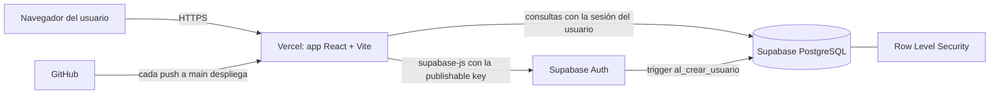
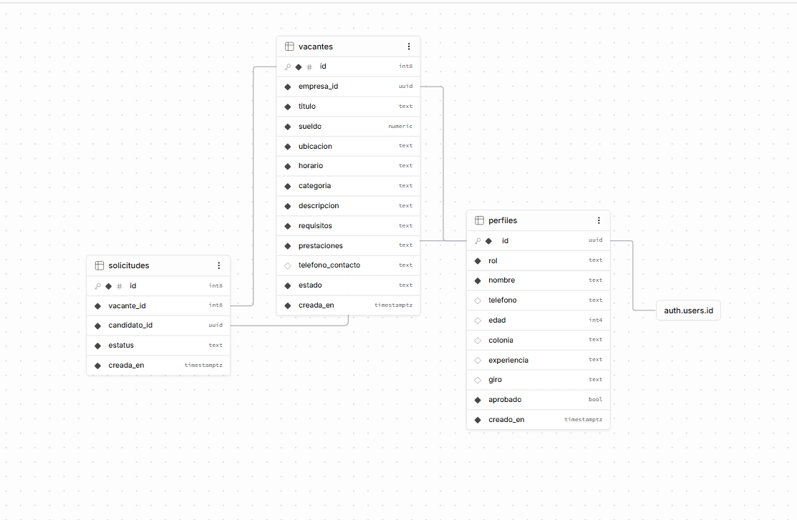
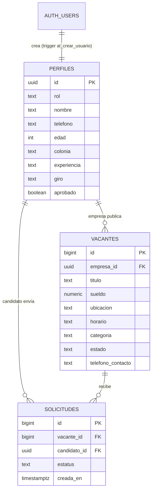

// Sitio publicado
https://amac-web-one.vercel.app/

// Video de la presentación y diapositivas
- Video: (pegar enlace)

// Integrantes y qué hizo cada uno

- Luis Mario Cortez Castro - Manejo del código
- Milton Carlos Leal Tamez - Manejo del código
- Julio Eduardo Gomez Wilson - Gestión de presentación
- Carlos Ignacio Marván Ramirez - Gestión de presentación

// Cuentas de prueba

- Candidato aprobado -- correo: juliogomezw07@gmail.com -- contraseña: 12345678
- Candidato sin aprobar -- correo: juliogomezw@udem.edu -- contraseña: 123abcde
- Empresa -- correo: adriana.reynac@gmail.com -- contraseña: 12345678

// Tecnologías
- Interfaz: React 19, React Router 7 y Vite
- Estilos: CSS propio de la Entrega 2 (src/styles/), sin frameworks
- Backend: Supabase (PostgreSQL, Auth y Row Level Security)
- Despliegue: Vercel conectado a GitHub, con HTTPS

// Cómo correr el proyecto localmente
1. `npm install`
2. Crear `.env.local` (copiar `.env.example`) con `VITE_SUPABASE_URL` y `VITE_SUPABASE_PUBLISHABLE_KEY`
3. `npm run dev` y abrir http://localhost:5173

La base de datos se crea ejecutando `supabase/esquema.sql` en el SQL Editor de Supabase.

// Estructura del proyecto
- index.html
- vercel.json -- redirige todas las rutas a index.html para que React Router funcione al recargar
- supabase/esquema.sql -- SQL final: tablas, trigger, funciones y políticas RLS
- src/main.jsx -- BrowserRouter, AuthProvider y estilos
- src/App.jsx -- rutas públicas y protegidas por rol
- src/lib/ -- cliente de Supabase, formato, validación y hooks
- src/context/AuthContext.jsx -- sesión y perfil del usuario
- src/components/ -- Encabezado, Pie, Boton, CampoFormulario, TarjetaVacante, EtiquetaEstatus, RutaProtegida...
- src/pages/ -- una página por ruta
- src/styles/ -- variables.css, base.css, layout.css, componentes.css

// Rutas
- / -- Listado de vacantes -- Público
- /vacantes/:id -- Detalle de vacante -- Público
- /login -- Inicio de sesión -- Público
- /registro -- Registro de candidato -- Público
- /registro-empresa -- Registro de empresa -- Público
- /mis-solicitudes -- Mis solicitudes -- Candidato
- /empresa/vacantes -- Mis vacantes -- Empresa
- /empresa/publicar -- Publicar vacante -- Empresa
- /empresa/vacantes/:id/solicitudes -- Solicitudes recibidas -- Empresa

// Diagrama de arquitectura

// Diagrama de la base de datos

Captura del Schema Visualizer de Supabase:

- perfiles -- un perfil por usuario de Supabase Auth; rol candidato, empresa o admin
- vacantes -- estado activa, pausada o cerrada; sueldo mayor a 0
- solicitudes -- estatus Enviada, En revisión, Aceptada, Rechazada o Cancelada
- `unique (vacante_id, candidato_id)` -- una persona solo puede postularse una vez a cada vacante

// Políticas RLS
RLS está activo en las tres tablas. No hay políticas de borrado, así que nadie puede borrar filas desde la API.

perfiles
- perfiles_ver_propio -- cada usuario con sesión lee su propio perfil
- perfiles_ver_empresas -- cualquiera puede leer los perfiles de empresas (para mostrar el nombre en las vacantes)
- perfiles_empresa_ve_postulantes -- la empresa lee los perfiles de los candidatos que se postularon a sus vacantes
- perfiles_editar_propio -- cada usuario edita solo su perfil; por permisos de columna no puede cambiar rol ni aprobado

vacantes
- vacantes_ver_activas -- sin sesión solo se ven las vacantes activas
- vacantes_ver -- con sesión se ven las activas, las propias de la empresa y aquellas a las que el candidato se postuló
- vacantes_publicar -- solo una empresa puede crear vacantes, y solo a su nombre
- vacantes_editar -- la empresa solo edita (pausa, reactiva, cierra) sus propias vacantes

solicitudes
- solicitudes_ver -- el candidato ve sus solicitudes y la empresa ve las de sus vacantes
- solicitudes_postular -- solo un candidato aprobado se postula, a su nombre, con estatus Enviada y a una vacante activa
- solicitudes_cancelar -- el candidato solo puede cambiar a Cancelada sus solicitudes en Enviada o En revisión
- solicitudes_responder -- la empresa solo puede cambiar a En revisión, Aceptada o Rechazada las solicitudes de sus vacantes

Trigger y funciones:
- crear_perfil() + trigger al_crear_usuario -- crea la fila en perfiles al registrarse; solo acepta candidato o empresa
- mi_rol(), candidato_aprobado(), candidato_aplico(vid), empresa_ve_candidato(cid), vacante_es_mia(vid), vacante_activa(vid) -- funciones security definer que usan las políticas para no caer en bucles de RLS

// Seguridad
- `.env.local` no está en GitHub (está en .gitignore)
- La llave service_role / secret key no aparece en el código; el frontend solo usa la publishable key
- RLS activado en todas las tablas
- Las contraseñas las maneja solo Supabase Auth
- La aprobación de candidatos (RF-054) la hace el equipo desde el Table Editor cambiando aprobado a true

// Requerimientos funcionales implementados
✅ completo / 🟡 parcial / ❌ pendiente

| # | RF | Funcionalidad | Estado |
|---|---|---|---|
| 1 | RF-001 | Listado de vacantes activas desde la BD | ✅ |
| 2 | RF-002, RF-007 | Búsqueda por palabra clave, filtros por horario y categoría, mensaje "No hay vacantes para mostrar" | ✅ |
| 3 | RF-003, RF-051 | Detalle de vacante; botón "Llamar" solo si hay teléfono | ✅ |
| 4 | RF-011, RF-012, RF-013 | Registro de candidato con casilla obligatoria de términos | ✅ |
| 5 | RF-008, RF-009 | Inicio y cierre de sesión con error genérico | ✅ |
| 6 | RF-004, RF-054 | Postularse solo si está aprobado, sin duplicados, con confirmación | ✅ |
| 7 | RF-005, RF-006 | Mis solicitudes y cancelar con confirmación | ✅ |
| 8 | RF-015 | Registro de empresa | ✅ |
| 9 | RF-019 | Publicar vacante con validación; teléfono solo si elige postulaciones por teléfono | ✅ |
| 10 | RF-020, RF-021 | Mis vacantes con número de solicitudes; pausar, reactivar y cerrar | ✅ |
| 11 | RF-022, RF-024 | Solicitudes recibidas y cambio de estatus | ✅ |
| - | RF-010 | Rutas protegidas por rol | ✅ |
| Extra | RF-054 | Panel de administrador para aprobar candidatos | ❌ |
| Extra | RF-014, RF-017 | Editar perfil | ❌ |
| Extra | RF-016 | Logo de empresa con Supabase Storage | ❌ |
| Extra | RF-041 | Vacantes favoritas | ❌ |
| Extra | RF-029 | Recuperar contraseña | ❌ |

// Colores y tipografías
src/styles/variables.css

- --color-primario -- #1f2a4a
- --color-acento -- #ff7f5c -- botón principal y ayuda
- --color-texto -- #1b2440 -- Texto principal
- --color-superficie -- #ebebeb -- Fondo de página

Tipografías: Libre Baskerville para títulos e Inter para texto. El texto base es de 18px/1.125 rem

// Componentes reutilizables
.boton, .tarjeta, .tarjeta-vacante, .solicitud, .vacante-empresa, .campo-formulario, .campo-casilla, .grupo-campos, .etiqueta-estatus, .encabezado, .nav-principal, .nav-inferior, .pie, .buscador

