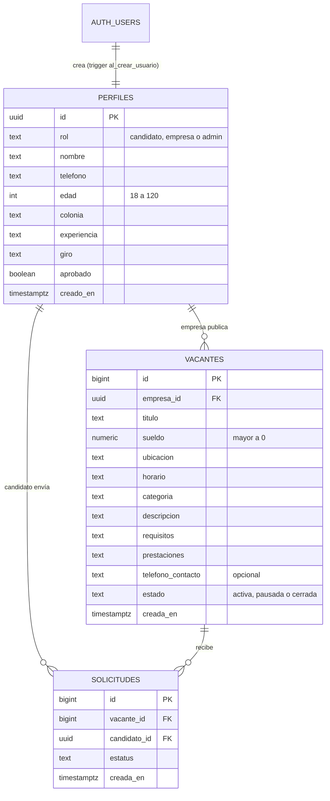

# Plataforma de empleo AMAC (OT2026-WEB)

Entrega 3 (final). Aplicación web que conecta a personas adultas mayores con vacantes de empresas. Es una SPA en React con Vite, usa Supabase (PostgreSQL, Auth y Row Level Security) como backend y se despliega en Vercel.

- **Sitio publicado:** https://amac-web-one.vercel.app/
- **Repositorio:** https://github.com/luismg3t/amac-web
- **Entrega 2 (HTML y CSS):** se conserva completa en la rama [`entrega-2`](https://github.com/luismg3t/amac-web/tree/entrega-2)

## Integrantes

| Integrante | Responsabilidad |
|---|---|
| Luis Mario Cortez Castro | Manejo del código |
| Milton Carlos Leal Tamez | Manejo del código |
| Julio Eduardo Gomez Wilson | Gestión de presentación |
| Carlos Ignacio Marván Ramirez | Gestión de presentación |

## Tecnologías

| Capa | Herramienta |
|---|---|
| Interfaz | React 19, React Router 7, Vite 8 |
| Estilos | CSS propio de la Entrega 2 (`src/styles/`), sin frameworks |
| Backend | Supabase: PostgreSQL, Auth y Row Level Security |
| Despliegue | Vercel |

## Instalación local

Requisitos: Node.js 20.19 o superior (o 22.12 o superior) y una cuenta de Supabase.

1. Clona el repositorio e instala las dependencias.

   ```bash
   git clone https://github.com/luismg3t/amac-web.git
   cd amac-web
   npm install
   ```

2. Crea un proyecto en [Supabase](https://supabase.com/dashboard).

3. En el proyecto, abre **SQL Editor**, pega el contenido completo de [`supabase/esquema.sql`](supabase/esquema.sql) y ejecútalo. El script se puede volver a ejecutar sin perder datos.

4. Copia `.env.example` como `.env.local` y llena las dos variables con los datos de **Project Settings → API Keys**.

   ```
   VITE_SUPABASE_URL=https://TU-PROYECTO.supabase.co
   VITE_SUPABASE_PUBLISHABLE_KEY=sb_publishable_...
   ```

5. Inicia el servidor de desarrollo.

   ```bash
   npm run dev
   ```

| Comando | Qué hace |
|---|---|
| `npm run dev` | Servidor de desarrollo |
| `npm run build` | Compila la versión de producción en `dist/` |
| `npm run preview` | Sirve la compilación de `dist/` |

### Configuración de Supabase

- **Confirmación de correo.** Supabase la pide por defecto: la persona debe abrir el enlace que recibe antes de iniciar sesión. Para pruebas se puede desactivar en **Authentication → Sign In / Providers → Email → Confirm email**.
- **Aprobar candidatos.** Un candidato nuevo queda con `aprobado = false` y no puede postularse. AMAC lo aprueba desde **SQL Editor**:

  ```sql
  update public.perfiles
  set aprobado = true
  where id = (select id from auth.users where email = 'correo@ejemplo.com');
  ```

- **Rol de administrador.** El registro solo crea candidatos y empresas. El rol `admin` se asigna a mano:

  ```sql
  update public.perfiles
  set rol = 'admin'
  where id = (select id from auth.users where email = 'correo@ejemplo.com');
  ```

### Despliegue en Vercel

1. Importa el repositorio en Vercel. El preset **Vite** se detecta solo (`npm run build`, carpeta `dist`).
2. En **Settings → Environment Variables** agrega `VITE_SUPABASE_URL` y `VITE_SUPABASE_PUBLISHABLE_KEY`.
3. Despliega. [`vercel.json`](vercel.json) redirige todas las rutas a `index.html` para que React Router funcione al recargar la página.

## Estructura del proyecto

```
amac-web/
├── index.html
├── vercel.json
├── public/img/               logotipo
├── docs/capturas/            capturas del validador y de Lighthouse
├── supabase/esquema.sql      tablas, trigger, funciones y políticas RLS
└── src/
    ├── main.jsx              BrowserRouter, AuthProvider y estilos
    ├── App.jsx               rutas públicas y protegidas por rol
    ├── lib/                  cliente de Supabase, formato, validación y hooks
    ├── context/AuthContext.jsx
    ├── components/           Encabezado, Pie, Boton, TarjetaVacante, EtiquetaEstatus, RutaProtegida…
    ├── pages/                una página por ruta
    └── styles/               variables.css, base.css, layout.css, componentes.css
```

### Rutas

| Ruta | Página | Acceso |
|---|---|---|
| `/` | `ListadoVacantes` | Público |
| `/vacantes/:id` | `DetalleVacante` | Público |
| `/login` | `Login` | Público |
| `/registro` | `RegistroCandidato` | Público |
| `/registro-empresa` | `RegistroEmpresa` | Público |
| `/mis-solicitudes` | `MisSolicitudes` | Candidato |
| `/empresa/vacantes` | `EmpresaVacantes` | Empresa |
| `/empresa/publicar` | `PublicarVacante` | Empresa |
| `/empresa/vacantes/:id/solicitudes` | `SolicitudesRecibidas` | Empresa |

## Base de datos



`solicitudes` tiene la restricción `unique (vacante_id, candidato_id)`: una persona solo puede postularse una vez a cada vacante.

Diagrama de arquitectura: _pendiente — agregar la imagen en `docs/diagrama.png` y enlazarla aquí._

## Seguridad

- El frontend solo usa `VITE_SUPABASE_URL` y `VITE_SUPABASE_PUBLISHABLE_KEY`. La llave `service_role` / `secret key` no aparece en el código ni en el repositorio.
- `.env.local` está en `.gitignore`.
- Las contraseñas y sesiones las maneja únicamente Supabase Auth.
- La protección real de los datos está en PostgreSQL: Row Level Security y permisos por columna. Las validaciones de la interfaz son solo una ayuda para la persona.

### Trigger y funciones auxiliares

| Elemento | Qué hace |
|---|---|
| `crear_perfil()` + trigger `al_crear_usuario` | Al crearse un usuario en `auth.users` inserta su fila en `perfiles` con los datos de `raw_user_meta_data`. Solo acepta los roles `candidato` y `empresa`: nadie puede registrarse como `admin` |
| `mi_rol()` | Rol del usuario en sesión |
| `candidato_aprobado()` | Verdadero si el usuario es candidato y está aprobado |
| `candidato_aplico(vid)` | Verdadero si el usuario se postuló a la vacante |
| `empresa_ve_candidato(cid)` | Verdadero si el candidato se postuló a una vacante de la empresa en sesión |
| `vacante_es_mia(vid)` | Verdadero si la vacante pertenece a la empresa en sesión |
| `vacante_activa(vid)` | Verdadero si la vacante está activa |

Las funciones son `security definer` para que las políticas puedan consultar otras tablas sin provocar bucles de RLS. Solo el rol `authenticated` puede ejecutarlas.

### Políticas RLS

RLS está activo en las tres tablas. Nadie puede borrar filas desde la API.

**`perfiles`**

| Operación | Quién | Regla |
|---|---|---|
| Leer | Usuario con sesión | Su propio perfil |
| Leer | Todos | Perfiles con `rol = 'empresa'`. Sin sesión solo se leen `id`, `rol`, `nombre` y `giro` |
| Leer | Empresa | Perfiles de candidatos que se postularon a sus vacantes |
| Editar | Usuario con sesión | Su propio perfil, y solo `nombre`, `telefono`, `edad`, `colonia`, `experiencia` y `giro`. `rol` y `aprobado` no se pueden modificar |

**`vacantes`**

| Operación | Quién | Regla |
|---|---|---|
| Leer | Sin sesión | Vacantes con `estado = 'activa'` |
| Leer | Con sesión | Activas, las propias de la empresa y aquellas a las que el candidato se postuló |
| Crear | Empresa | `empresa_id = auth.uid()` y `mi_rol() = 'empresa'` |
| Editar | Empresa dueña | Misma regla. No puede cambiar `id`, `empresa_id` ni `creada_en` |

**`solicitudes`**

| Operación | Quién | Regla |
|---|---|---|
| Leer | Candidato | Sus propias solicitudes |
| Leer | Empresa | Solicitudes de sus vacantes |
| Crear | Candidato aprobado | `candidato_id = auth.uid()`, `estatus = 'Enviada'`, `candidato_aprobado()` y vacante activa |
| Editar | Candidato | Solo `estatus`, a `'Cancelada'`, y si estaba en `'Enviada'` o `'En revisión'` |
| Editar | Empresa dueña | Solo `estatus`, a `'En revisión'`, `'Aceptada'` o `'Rechazada'`, y si no estaba `'Cancelada'` |

## Requerimientos funcionales

| RF | Requerimiento | Dónde está |
|---|---|---|
| RF-001 | Listado de vacantes activas con el nombre de la empresa | `src/pages/ListadoVacantes.jsx`, `src/components/TarjetaVacante.jsx` |
| RF-002, RF-007 | Búsqueda por palabra clave en título o ubicación sin distinguir mayúsculas, filtros por horario y categoría, y mensaje "No hay vacantes para mostrar." | `src/pages/ListadoVacantes.jsx` |
| RF-003, RF-051 | Detalle de la vacante; el enlace "Llamar" solo aparece si hay `telefono_contacto` | `src/pages/DetalleVacante.jsx` |
| RF-004, RF-054 | Postulación solo para candidatos aprobados, con avisos de duplicado y de registro no aprobado, y confirmación en pantalla | `src/pages/DetalleVacante.jsx`, política `solicitudes_postular` |
| RF-005, RF-006 | Mis solicitudes con fecha, vacante, empresa y estatus; cancelación con confirmación, imposible si está aceptada o rechazada | `src/pages/MisSolicitudes.jsx`, política `solicitudes_cancelar` |
| RF-008, RF-009 | Inicio y cierre de sesión; error genérico "Correo o contraseña incorrectos." | `src/pages/Login.jsx`, `src/components/EnlaceNav.jsx`, `src/context/AuthContext.jsx` |
| RF-010 | Rutas protegidas: sin sesión van a `/login`; con otro rol van a `/` | `src/components/RutaProtegida.jsx`, `src/App.jsx` |
| RF-011, RF-012, RF-013 | Registro de candidato con nombre, correo, contraseña, teléfono, edad, colonia, experiencia y casilla obligatoria de términos | `src/pages/RegistroCandidato.jsx`, trigger `al_crear_usuario` |
| RF-015 | Registro de empresa con nombre, giro, teléfono, correo y contraseña | `src/pages/RegistroEmpresa.jsx` |
| RF-019 | Publicar vacante con validación de campos; `telefono_contacto` solo se habilita y guarda si se eligen postulaciones por teléfono | `src/pages/PublicarVacante.jsx` |
| RF-020, RF-021 | Mis vacantes con conteo de solicitudes y botones para pausar, reactivar y cerrar | `src/pages/EmpresaVacantes.jsx` |
| RF-022, RF-024 | Solicitudes recibidas con nombre, edad, colonia y experiencia, sin las canceladas, y cambio de estatus | `src/pages/SolicitudesRecibidas.jsx`, política `solicitudes_responder` |

## Cuentas de prueba

_Llenar con las cuentas creadas en el proyecto de Supabase antes de entregar._

| Rol | Correo | Contraseña | Notas |
|---|---|---|---|
| Candidato aprobado | | | Puede postularse |
| Candidato sin aprobar | | | Ve el aviso de registro no aprobado |
| Empresa | | | Tiene vacantes publicadas |

## Diseño y accesibilidad

Se conservan los estilos, las clases y las reglas de accesibilidad de la Entrega 2.

- **Colores** (`src/styles/variables.css`): primario `#1f2a4a`, acento `#ff7f5c`, texto `#1b2440`, fondo de página `#ebebeb`.
- **Tipografías:** Libre Baskerville para títulos e Inter para el texto. El texto base es de 18 px (1.125 rem).
- **Responsivo:** de 320 px a 1440 px, con puntos de quiebre en 768, 1024 y 1280 px.
- **Accesibilidad:** foco visible, enlace "Saltar al contenido", etiquetas vinculadas a cada campo, mensajes de error asociados al campo y anunciados a lectores de pantalla, y botones de al menos 56 px de alto.
- **Componentes de estilo:** `.boton`, `.tarjeta`, `.tarjeta-vacante`, `.solicitud`, `.vacante-empresa`, `.campo-formulario`, `.campo-casilla`, `.grupo-campos`, `.etiqueta-estatus`, `.encabezado`, `.nav-principal`, `.nav-inferior`, `.pie`, `.buscador`.

### Capturas

Las capturas del validador de la Entrega 2 están en [`docs/capturas/`](docs/capturas/).

_Pendiente: agregar las capturas de la Entrega 3 en celular y escritorio, y el puntaje de Lighthouse._
